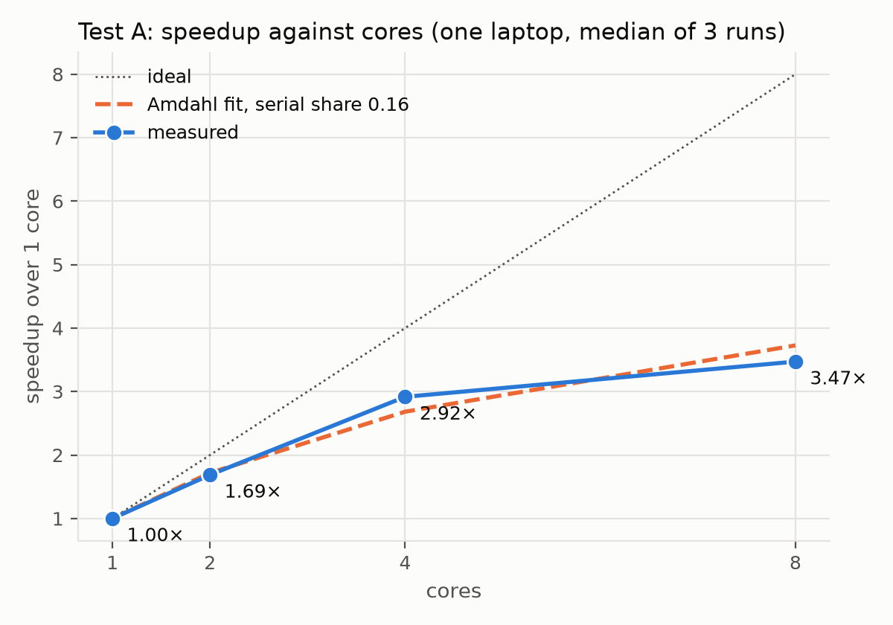
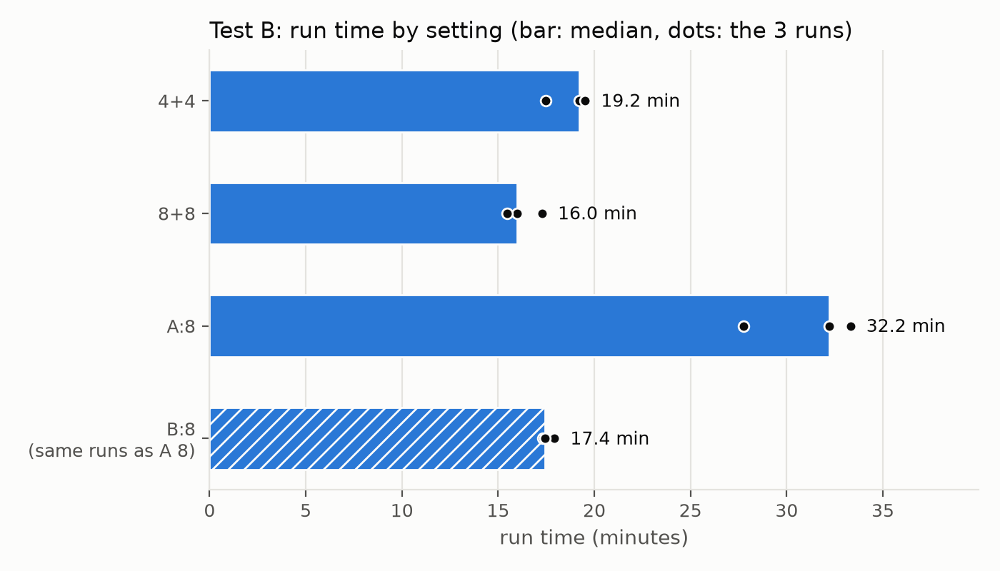
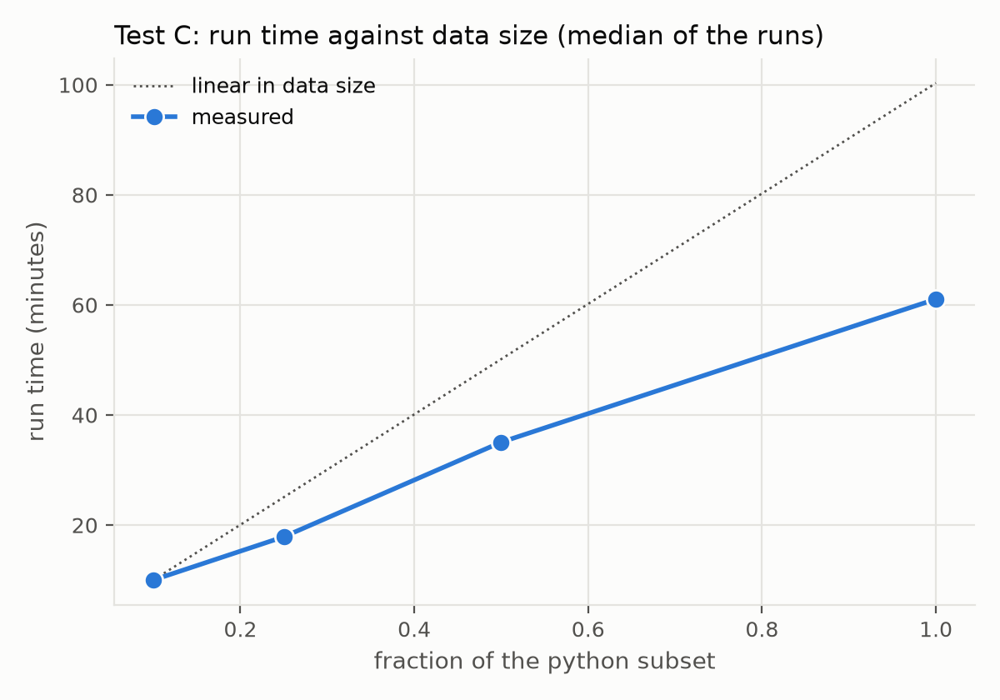

# E8: speedup analysis (#15)

Input: `results/e8_scaling/runs.csv` (WS4's table; how the runs were made is in `docs/e8_runbook.md`),
25% of the Stack Overflow python subset, LSH setting `chosen`, 3 runs per setting, medians below.
Reproduce the tables and plots with `python -m src.scaling.analyze`.

| Test A cores | Run time (s) | Speedup | Efficiency | Amdahl fit |
|---|---|---|---|---|
| 1 | 3632.0 | 1.00 | 100% | 1.00 |
| 2 | 2152.9 | 1.69 | 84% | 1.72 |
| 4 | 1245.2 | 2.92 | 73% | 2.68 |
| 8 | 1046.2 | 3.47 | 43% | 3.73 |

| Test C fraction | Run time (s) | Slowest task (s) | Median task (s) | Shuffle written (GB) |
|---|---|---|---|---|
| 0.10 | 601.9 | 91.5 | 1.65 | 11.56 |
| 0.25 | 1073.1 | 194.5 | 3.43 | 28.14 |
| 0.50 | 2103.9 | 330.0 | 4.58 | 56.72 |
| 1.00 | 3663.7 | 566.0 | 5.35 | 115.94 |

## What limits the speedup

On one laptop, 2, 4 and 8 cores give speedups of 1.69, 2.92 and 3.47, so efficiency falls from 84% to 43% and going from 4 to 8 cores shortens the run by only 16%. An Amdahl fit gives a serial share of 0.16 (a ceiling of about 6×), but the fit is rough, with 2.68 predicted against 2.92 measured at 4 cores and 3.73 against 3.47 at 8, so read the share as a summary of all overheads and not as code that runs on one core. Three stages (12, 15 and 17 in `stages.csv`) take 88 to 92% of the run time and speed up 3.4 to 3.9 times from 1 to 8 cores. The median task slows from 1.54 s on 1 core to 2.44 s on 8, which suggests that tasks running side by side compete for a shared resource, although the table cannot say whether that is memory, disk or CPU. Long tasks also limit what more cores can do: the longest single task took 196 s at 8 cores, 19% of the run, and extra cores cannot shorten a task. The shuffle written stays at 28.0 GB in every setting, so all settings do the same amount of shuffle work, but how much of it crosses the network in the two-laptop runs is not recorded. With input on HDFS in both cases, the two laptops at 8+8 finished in 16.0 minutes against 32.2 on Laptop A alone (2.01 times faster), while going from 4+4 to 8+8 gained only 1.20 times. The 4+4 and 8+8 runs have 7 and 10 stages that take at least 5 s but under 2 s on 8 cores of Laptop B alone, adding about 88 s and 117 s (8% and 12% of the run); Laptop A alone has one such stage, and the cause of these pauses is not established. The `B:8` rows are copies of the 8-core test A runs, which read local files instead of HDFS, so they should not be compared with the other test B settings to judge the second machine. For data-size scaling (test C on `8+8`, `runs_data_scaling.csv`), moving across 10%, 25%, 50%, and 100% of the python subset (`10×` data) increases median runtime from 601.9 s to 1073.1 s (`1.78×`), 2103.9 s (`3.50×`), and 3663.7 s (`6.09×`), while shuffle written scales linearly (`10.03×`: 11.56 GB → 28.14 GB → 56.72 GB → 115.94 GB). Note that the `1.00` runs were executed after restarting both laptops with `spark.speculation true` (see `docs/e8_runbook.md`, #43).

## Files

| File | What it holds |
|---|---|
| `summary.csv` | Per setting: median, minimum and maximum time, longest and median task, shuffle written, and whether its runs are copies of another setting |
| `stages.csv` | Median duration of every stage per setting, in seconds |
| `speedup_cores.png`, `second_machine.png`, `data_size.png` | The three scaling plots |
