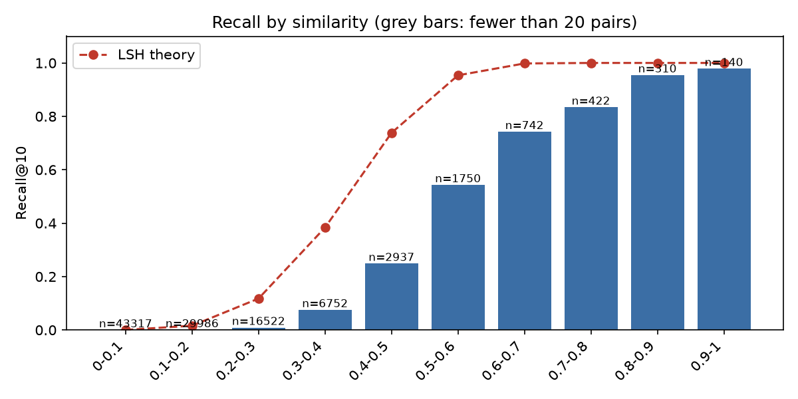

# Error analysis: which duplicates does the system miss? (#33)

Full run on the Stack Overflow python subset with the chosen setting: word 1-grams of the title, MinHash
n = 128 (seed 42), LSH b = 32, r = 4, buckets over 1,000 members skipped. The input is the per-pair table
(contract C8) of that run: **102,878 labelled duplicate pairs**, found and missed. The table is not in git.

Its Recall@1, @5, @10, Precision@10 and MAP, recomputed from the table, match the `chosen`, 100% row of
[`../metrics.csv`](../metrics.csv). The code commit and command that wrote this copy of the table were not
recorded with it.

## Reproduce

How to write the table on the cluster is in [`src/evaluation/README.md`](../../src/evaluation/README.md).
Then:

```bash
python -m src.evaluation.errors --per-pair per_pair_chosen --out results/error_analysis --bands 32 --rows 4
```

| File | What it holds |
|---|---|
| `recall_by_similarity.csv`, `.png` | Recall@10 by exact title Jaccard (bins of 0.1), with the LSH theory per bin |
| `recall_by_tags.csv`, `.png` | The 20 most frequent tags of the newer question (`python` is on every pair) |
| `recall_by_length.csv`, `.png` | By body length of the newer question, in characters |
| `recall_by_year.csv`, `.png` | By year of the newer question |
| `misses.csv` | The first 20 pairs missed at rank 10, ordered by question id |

Here **recall counts every pair once: 3.6%**. `metrics.csv` averages over questions, some of which have
several originals, and gives 3.8%. No bin has fewer than 20 pairs.



## Why duplicates are missed

With b = 32 and r = 4, LSH theory gives a pair of Jaccard similarity s the chance 1 − (1 − s⁴)³² of
becoming a candidate, which passes 50% at s = 0.38 (at the usual approximate threshold (1/b)^(1/r) = 0.42
it is already 64%). Most labelled duplicates are far below that point: 71.3% have a title similarity under
0.2, and 96.2% of the pairs missed at rank 10 are below 0.38.
Summed over all pairs, the theory expects 9,702 candidates (9.4%) even without a bucket limit and the run
produced 8,535 (8.3%), so low title overlap explains most misses, while the difference of about 1.1 points
is an estimate of everything else, the bucket limit included, and not a measurement of it. Ranking is a
second cause: of the 8,535 candidates, 2,019 rank below 100 and 2,819 rank 11 to 100, which leaves 3,697
in the top 10. At similarity 0.4 to 0.6 the theory expects 75.8% of pairs to become candidates, but 61.8%
reach the top 100 and 35.9% the top 10, so the gap to the theory line in the plot mixes lost candidates
with ranking. At 0.8 and above, 96.2% of pairs are in the top 10, including all 92 pairs with identical
title shingles. Differences between tags and years go partly with title similarity, but even for pairs at
0.42 or above the share in the top 10 fell from 85% in 2009 to 43% in 2022 before rising again, and this
analysis does not establish why.

Body length makes little difference (3.3% to 5.0%), which is unsurprising because only titles are
shingled.

## Where the pairs are lost

| Outcome | Pairs | Share |
|---|---:|---:|
| In the top 10 | 3,697 | 3.6% |
| Ranked 11 to 100 | 2,819 | 2.7% |
| A candidate, ranked below 100 | 2,019 | 2.0% |
| Never a candidate | 94,343 | 91.7% |
| **All labelled pairs** | **102,878** | **100%** |

The per-pair table keeps ranks up to 100. "Never a candidate" is `lost_answer_pairs` of the
`size_limit` row in [`../e7_buckets/bucket_comparison.csv`](../e7_buckets/bucket_comparison.csv), a run with
the same settings, candidate count and Recall@10. The other three rows come from the per-pair table. The
theory figures are computed from its exact similarities:

```python
import pandas as pd

pairs = pd.read_parquet("per_pair_chosen")
chance = 1 - (1 - pairs.exact_jaccard**4) ** 32
print(round(chance.sum()), (pairs["rank"] <= 10).sum(), pairs.found.sum())  # 9702 3697 6516
```

## The first 20 misses, grouped by reason

All 20 were missed at rank 10, and none is in the top 100. They are grouped by exact title similarity,
which sets the chance of meeting in LSH; the question texts were not read. They are the lowest question
ids, so **all are from 2008 and they are not a sample of all misses**.

| Reason | Pairs | Chance of becoming a candidate | Newer question ids |
|---|---:|---|---|
| The titles share no word (J = 0) | 3 | 0% | 42558, 286150 (two originals) |
| Very little overlap (0 < J < 0.2) | 10 | up to 2.4% | 49146, 106725, 143714, 150743, 190967, 196876, 239912, 268025, 270460, 302729 |
| Below the 50% point (0.2 ≤ J < 0.38) | 6 | 5.0% to 44.8% | 108523, 192109, 204017, 237079, 269795, 287085 |
| Above the 50% point (J ≥ 0.38) | 1 | 72.0% | 276434 (J = 0.44) |

For the first three groups, 19 of the 20, a miss is the likely result of LSH at these similarities. For the
last pair the table cannot tell whether it never became a candidate (a 28% chance in theory, or the bucket
limit) or ranked below 100. A question can be opened at `https://stackoverflow.com/q/<id>`.

## Limits

- Duplicate labels are incomplete: only links that users added are counted.
- The theory is an expectation over MinHash. In E3 the measured and predicted curves differed by 1 to 3
  points on average, which is as large as the 1.1-point difference above.
- The share of misses caused only by the bucket limit has not been measured.
- The pair counts printed on the tag and year charts overlap; the exact counts are in the CSV files.
